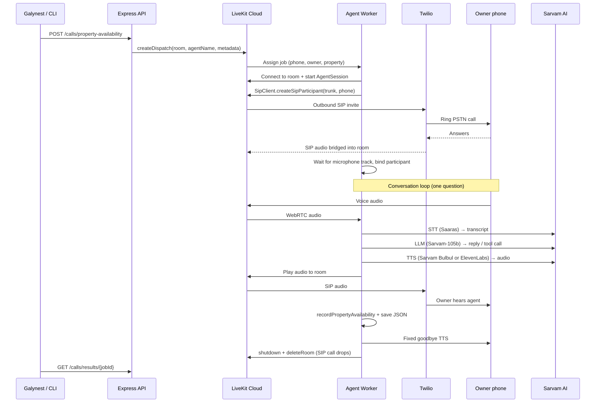

# Gully Voice Agent

**Modular Sarvam AI + LiveKit voice agent for Galynest automated outbound calls.**  
Calls property owners in **English, Hindi, or Kannada** and asks **one question**: is the property still available?

Built with **TypeScript**, **LiveKit Agents (Node.js)**, **Twilio SIP** (PSTN), **Sarvam AI** (Saaras STT + Sarvam LLM), and selectable **Sarvam or ElevenLabs TTS**.

---

## Overview

When Galynest needs to verify a listing, this system:

1. Receives a call job (API or CLI) with owner phone + property details
2. Dispatches a LiveKit agent job
3. Dials the owner over the normal phone network (PSTN) via Twilio + LiveKit SIP
4. Runs a short voice conversation (STT → LLM → TTS)
5. Records yes/no availability, says thank you, hangs up
6. Persists call outcome to Postgres (when `DATABASE_URL` is set) and a JSON file on the worker

---

## Why each service exists

Think of the call as three layers: **phone network**, **call room**, and **AI brain**.

| Service | Layer | Why we need it |
|---------|--------|----------------|
| **Twilio** | Phone network (PSTN) | Owns a real phone number and can place/receive calls on India’s public telephone network. LiveKit alone cannot dial `+91…` without a carrier. |
| **LiveKit** | Real-time call room + agent runtime | Creates a WebRTC “room”, bridges SIP audio from Twilio into that room, runs your Agent Worker, and manages session lifecycle (listen / speak / hang up). |
| **Sarvam AI** | Speech + language intelligence | Converts speech to text and generates reply text in Indian languages. It also provides Bulbul TTS when selected. |
| **ElevenLabs** | Optional natural voice | Replaces only the TTS “mouth” for more natural speech. Sarvam remains the STT “ears” and LLM “brain”. |
| **This repo (worker + API)** | Your product logic | Decides *what* to ask, *when* to hang up, and *where* to save results. |

**In one line:** Twilio dials the phone → LiveKit carries the audio and runs the agent → Sarvam understands and speaks → our code runs the Galynest script.

```
Owner's phone (PSTN)
        ▲
        │  carrier audio (Twilio)
        │
   Twilio SIP Trunk
        ▲
        │  SIP
        │
   LiveKit Cloud (room + SIP bridge + job dispatch)
        ▲
        │  WebRTC / agent protocol
        │
   Agent Worker (this repo)
        │
        ├── LiveKit adapters (dial, session, hangup)
        ├── Property agent (one question + tool)
        └── Sarvam pipeline (STT / LLM / TTS)
```

---

## Current architecture

```
┌──────────────────────────────────────────────────────────────────────────────┐
│                        GULLY VOICE AGENT (TypeScript)                        │
├──────────────────────────────────────────────────────────────────────────────┤
│                                                                              │
│  GullyNest API ◄──GET /api/voice-admin/properties── Voice Cron (interval)   │
│       │                                              fetch → dispatch each   │
│       │                                                                      │
│  Galynest Backend ──POST /calls/...──► Express API (src/api/server.ts)      │
│                                              │                               │
│                                              │ AgentDispatchClient           │
│                                              ▼                               │
│                         ┌─────────────────────────────────┐                  │
│                         │         LiveKit Cloud           │                  │
│                         │  dispatch job → assign worker   │                  │
│                         │  WebRTC room + SIP bridge       │                  │
│                         └─────────────┬───────────────────┘                  │
│                                       │                                      │
│                                       ▼                                      │
│  ┌────────────────────────────────────────────────────────────────────────┐  │
│  │                     Agent Worker (this process)                        │  │
│  │                                                                        │  │
│  │  worker.ts (orchestrator)                                              │  │
│  │       │                                                                │  │
│  │       ├── SarvamVoicePipeline     ears / brain / mouth (STT/LLM/TTS)   │  │
│  │       ├── LiveKitCallSession      conversation + goodbye + hangup      │  │
│  │       ├── LiveKitSipAdapter       dial + wait for mic track            │  │
│  │       └── PropertyAvailabilityAgent  domain script + one tool          │  │
│  │                                                                        │  │
│  │  After call: PATCH /api/voice-admin/properties/{id}/call-outcome       │  │
│  └────────────────────────────────────────────────────────────────────────┘  │
│                                       │                                      │
│                                       ▼                                      │
│                         Call logs (Postgres) + optional JSON snapshots       │
└──────────────────────────────────────────────────────────────────────────────┘
                                      │
                                      │ SIP outbound trunk
                                      ▼
                               Twilio ──► Owner phone (PSTN)
```

### Adapters (current layout)

| Module | Role (plain English) |
|--------|----------------------|
| `src/adapters/voice-pipeline.ts` | Interface for “build STT+LLM+TTS” |
| `src/adapters/sarvam-voice-pipeline.ts` | Sarvam implementation of that pipeline |
| `src/adapters/livekit-sip-adapter.ts` | Dial owner + wait until mic audio is in the room |
| `src/adapters/livekit-call-session.ts` | Start session, turn logs, thank-you, forced hangup |
| `src/core/worker.ts` | Thin entrypoint: connect → pipeline → session → dial → wait |
| `src/agents/property-availability/` | Domain agent: greet, ask availability, record, hang up |

---

## Information flow (step by step)



### What moves on the wire

| Hop | What travels |
|-----|----------------|
| Owner ↔ Twilio | Normal phone audio (PSTN) |
| Twilio ↔ LiveKit | SIP (signaling + media for the trunk) |
| LiveKit ↔ Worker | WebRTC room audio + agent control messages |
| Worker ↔ Sarvam | HTTPS/WebSocket API calls (text + audio streams) |

---

## Call script (current product behavior)

1. Wait for owner to speak first on real calls (typical “Hello?”)
2. Greet and ask: **is the property still available?**
3. Call tool `recordPropertyAvailability`
4. Save result to disk
5. Say thank you and hang up (no tenant / visit follow-ups)

---

## Project structure

```
voiceAgent/
├── src/
│   ├── adapters/                 # LiveKit + Sarvam integrations
│   │   ├── voice-pipeline.ts
│   │   ├── sarvam-voice-pipeline.ts
│   │   ├── livekit-sip-adapter.ts
│   │   └── livekit-call-session.ts
│   ├── agents/                   # Domain agents (pluggable)
│   │   ├── registry.ts
│   │   └── property-availability/
│   │       ├── agent.ts
│   │       └── prompts.ts
│   ├── config/                   # Settings (APP_ENV, keys, trunk id)
│   ├── core/
│   │   ├── worker.ts             # Job entrypoint orchestrator
│   │   ├── call-logger.ts        # Developer vs production stage logs
│   │   ├── language-manager.ts
│   │   └── sarvam-pipeline.ts    # Deprecated re-export wrapper
│   ├── jobs/                     # Dispatch + result store
│   ├── api/                      # Express trigger API
│   ├── workers/                  # LiveKit worker process entry
│   └── scripts/                  # CLI trigger
├── tests/
├── .env.example
└── package.json
```

---

## Glossary

| Term | Meaning |
|------|---------|
| **PSTN** | *Public Switched Telephone Network* — the real phone network (`+91…` mobiles/landlines). Not the internet. |
| **SIP** | *Session Initiation Protocol* — internet signaling used to set up/tear down voice sessions. LiveKit talks SIP to Twilio; Twilio talks PSTN to the phone. |
| **SIP trunk** | A configured “pipe” between LiveKit and a carrier (Twilio). Outbound trunk ID looks like `ST_…`. Without it, the agent cannot place phone calls. |
| **Trunk** | Short for SIP trunk — the telephony connection profile (credentials, numbers, routing) linking LiveKit ↔ Twilio. |
| **WebRTC** | Browser/app real-time media protocol. LiveKit rooms use WebRTC between cloud and the agent worker. |
| **Room** | A LiveKit session container. Owner (via SIP) and agent both join the same room so audio can flow. |
| **Participant** | Anyone in the room (agent, or `owner-{propertyId}` for the phone). |
| **Agent Worker** | Long-running Node process that registers with LiveKit and handles call jobs. |
| **Dispatch** | Asking LiveKit to start a specific agent (`AGENT_NAME`) in a room with metadata (phone, property). |
| **AgentSession** | LiveKit object that wires STT/LLM/TTS, turn-taking, `say()`, tools, and shutdown. |
| **STT** | *Speech-to-Text* — audio → transcript (Sarvam Saaras). |
| **LLM** | *Large Language Model* — decides what to say / which tool to call (Sarvam-105b). |
| **TTS** | *Text-to-Speech* — reply text → audio (selectable Sarvam Bulbul or ElevenLabs). |
| **VAD** | *Voice Activity Detection* — detects when someone is talking (we rely mainly on STT turn detection for phone). |
| **Tool / function call** | Structured action the LLM can invoke (e.g. `recordPropertyAvailability`) instead of only chatting. |
| **mulaw / PCM** | Audio encodings. PSTN often uses mulaw 8 kHz; this project uses PCM for outbound TTS and lets LiveKit resample for SIP reliability. |
| **DND / TRAI** | India telecom rules around who you may call; product compliance is outside this repo but required in production. |

---

## Prerequisites

| Service | Purpose |
|---------|---------|
| [Sarvam AI](https://dashboard.sarvam.ai) | STT, LLM, TTS for Indian languages |
| [LiveKit Cloud](https://cloud.livekit.io) | Rooms, agent dispatch, SIP bridge, worker jobs |
| [Twilio](https://www.twilio.com) (or similar) | PSTN carrier behind the LiveKit outbound SIP trunk |

---

## Quick Start

### 1. Install

```bash
cd voiceAgent
npm install
cp .env.example .env   # fill in API keys
```

### 2. Configure SIP (one-time)

1. Connect Twilio (or another carrier) as an **outbound SIP trunk** in LiveKit
2. Set `SIP_OUTBOUND_TRUNK_ID=ST_...` in `.env`
3. On Twilio trial accounts, destination numbers usually must be verified

### 3. Start the agent worker

```bash
npm run dev:worker
# or
npm run start:worker
```

Run **one** worker process while testing (stale workers cause duplicate jobs / weird SIP errors).

### 4. Test locally (no phone)

```bash
npm run console:worker
```

### 5. Start the trigger API

```bash
npm run dev:api
```

### 6. Trigger an outbound call

All `/calls/*` routes require `API_SECRET_KEY` via `Authorization: Bearer …` or `x-api-key`.

**Via API:**

```bash
# load API_SECRET_KEY from .env, then:
curl -X POST http://localhost:8080/calls/property-availability \
  -H "Content-Type: application/json" \
  -H "Authorization: Bearer $API_SECRET_KEY" \
  -d '{
    "owner_name": "Ramesh Kumar",
    "caller_name": "Jitesh",
    "phone_number": "+919876543210",
    "property_id": "PROP-001",
    "property_address": "42, 5th Cross, Indiranagar, Bangalore",
    "bhk": "2 BHK",
    "rent_amount": 25000,
    "city": "Bangalore",
    "preferred_language": "hi-IN",
    "tts_provider": "elevenlabs"
  }'
```

**Via CLI:**

```bash
npm run trigger:call -- \
  --owner-name "Ramesh Kumar" \
  --caller-name "Jitesh" \
  --phone "+919876543210" \
  --property-id "PROP-001" \
  --address "42, 5th Cross, Indiranagar, Bangalore" \
  --bhk "2 BHK" \
  --rent 25000 \
  --language hi-IN \
  --tts-provider elevenlabs
```

**Marketplace cron (fetch → dispatch on a fixed interval):**

Requires `VOICE_AGENT_API_BASE_URL`, `VOICE_AGENT_API_SECRET`, `DATABASE_URL`, and a running worker. Which properties to call is decided by the GullyNest API — this repo only fetches and dispatches.

```bash
npm run cron:voice              # runs forever (default every 15 min)
npm run cron:voice -- --once    # single tick (manual / smoke test)
```

When each call finishes, the worker PATCHes `/api/voice-admin/properties/{id}/call-outcome` (`yes`→`available`, `no`→`stale`, otherwise→`soft_stale`). See [`voice-agent-api.md`](voice-agent-api.md).

### 7. Fetch call result

```bash
curl http://localhost:8080/calls/results/{job_id} \
  -H "Authorization: Bearer $API_SECRET_KEY"
```

### 8. Call logging (Postgres + Drizzle)

Set `DATABASE_URL` on both the **API** and **worker** (Render Postgres or local). Apply the schema once:

```bash
# with DATABASE_URL in .env
psql "$DATABASE_URL" -f drizzle/0000_call_logs.sql
# or: npm run db:push
```

Each call is tracked in `call_logs` with:

| Field | Meaning |
|-------|---------|
| `status` | `dispatched` → `in_progress` → `completed` / `no_answer` / `failed` |
| `answered` | Owner picked up |
| `owner_outcome` | `yes`, `no`, `other` (unclear / inconclusive), or `not_asked` |
| `success` | `true` when a clear yes/no was captured on a completed call |
| `languages` | All language codes used during the call (e.g. `["hi-IN","en-IN"]`) |
| `transcript` | JSON array of `{ role, text, language?, timestamp }` |
| `transcript_summary` | Human-readable summary; for `other`, derived from what the owner said |

`GET /calls/results/:jobId` and `GET /calls/results` read from Postgres when `DATABASE_URL` is set; otherwise they fall back to JSON files in `call_results/`.

---

## Multilingual support

| Language | Code | Yes | No | TTS voice |
|----------|------|-----|-----|-----------|
| English | `en-IN` | yes, yeah | no, nope | aditya |
| Hindi | `hi-IN` | haan, ji | nahi, na | anand |
| Kannada | `kn-IN` | haudu | illa, beda | priya |

- **STT**: Saaras v3 (auto language detection)
- **LLM**: Sarvam-105b via OpenAI-compatible API (`https://api.sarvam.ai/v1`)
- **TTS**: `TTS_PROVIDER=sarvam` (Bulbul) or `elevenlabs` (multilingual voice)
- **Tools**: `recordPropertyAvailability`, `switchConversationLanguage`

### How response language is selected

1. `preferred_language` is the fallback before the owner speaks.
2. On every transcript, Sarvam STT's language code is preferred.
3. If STT has no code, script/keywords are used (Devanagari → Hindi, Kannada
   script → Kannada, and common Romanized words such as `haan` / `haudu`).
4. A detected mid-call change updates both the LLM instructions and the active
   TTS language. ElevenLabs keeps the configured voice while changing language;
   Sarvam changes its language-specific speaker.

---

## Environment variables

| Variable | Required | Description |
|----------|----------|-------------|
| `APP_ENV` | No | `developer` (default) or `production` |
| `CALL_DEBUG_LOGGING` | No | Override verbose `[CALL]` stage logs (`true`/`false`) |
| `LIVEKIT_URL` | Yes | LiveKit WebSocket URL |
| `LIVEKIT_API_KEY` | Yes | LiveKit API key |
| `LIVEKIT_API_SECRET` | Yes | LiveKit API secret |
| `SARVAM_API_KEY` | Yes | Sarvam AI API key |
| `TTS_PROVIDER` | No | `sarvam` (default) or `elevenlabs` |
| `ELEVEN_API_KEY` | For ElevenLabs | ElevenLabs API key |
| `ELEVENLABS_VOICE_ID` | No | Voice ID selected from ElevenLabs Voice Library |
| `ELEVENLABS_MODEL` | No | Default `eleven_v3` (English/Hindi/Kannada). Use `eleven_flash_v2_5` only for lower-latency English/Hindi. |
| `ELEVENLABS_TRANSPORT` | No | `http` (reliable default) or `websocket` (lower latency, currently susceptible to close code 1006) |
| `SIP_OUTBOUND_TRUNK_ID` | For phone calls | Outbound SIP trunk (`ST_...`) |
| `DATABASE_URL` | For DB logging | Postgres connection string (Drizzle). Enables `call_logs` persistence and API result reads |
| `AGENT_NAME` | No | Dispatch name (default: `gully-property-availability-agent`) |
| `COMPANY_NAME` | No | Brand name (default: `Galynest`) |
| `CALLER_NAME` | No | Spoken caller name (default: `Jitesh`); API `caller_name` can override it per call |
| `API_HOST` / `API_PORT` | No | Trigger API bind address |
| `API_SECRET_KEY` | Yes (API) | Bearer / `x-api-key` secret for `/calls/*` and `POST /suppressed-numbers` |
| `API_READ_RATE_LIMIT_PER_MINUTE` | No | Per-IP limit for `GET /calls/results*` (default `60`/min) |
| `API_SUPPRESSION_WRITE_RATE_LIMIT_PER_MINUTE` | No | Per-IP limit for `POST /suppressed-numbers` (default `10`/min) |
| `DISPATCH_COOLDOWN_MS` | No | Min ms between same property+phone (default 24h) |
| `CALLING_HOURS_START_HOUR` / `CALLING_HOURS_END_HOUR` | No | Quiet-hours window (default 9–20) |
| `CALLING_HOURS_TZ` | No | Time zone for calling hours (default `Asia/Kolkata`) |
| `CALL_DATA_RETENTION_DAYS` | No | Days to keep transcripts in Postgres (default `15`) |
| `VOICE_AGENT_API_BASE_URL` | For cron/outcomes | GullyNest marketplace host (no trailing slash) |
| `VOICE_AGENT_API_SECRET` | For cron/outcomes | Shared `X-Voice-Admin-Secret` |
| `VOICE_CRON_INTERVAL_MS` | No | Ms between fetch+dispatch ticks (default `900000` = 15 min) |

### Logging

- `APP_ENV=developer` → verbose `[CALL]` stage tracing (default)
- `APP_ENV=production` → warn/error only (unless `CALL_DEBUG_LOGGING=true`)

---

## Scripts

| Command | Description |
|---------|-------------|
| `npm run dev:worker` | Agent worker (dev) |
| `npm run start:worker` | Agent worker (start) |
| `npm run console:worker` | Terminal test (no phone) |
| `npm run dev:api` | Express trigger API |
| `npm run trigger:call` | CLI dispatch |
| `npm run cron:voice` | Interval cron: fetch GullyNest properties and dispatch calls |
| `npm run db:push` | Push Drizzle schema to Postgres |
| `npm run db:generate` | Generate SQL migrations from schema |
| `npm run db:migrate` | Apply SQL migrations |
| `npm test` | Unit tests |
| `npm run typecheck` | TypeScript check |

---

## Adding a new voice agent

```typescript
// src/agents/rent-reminder/agent.ts
import { registerAgent } from '../registry.js';
import { voice, llm } from '@livekit/agents';

class RentReminderAgent extends voice.Agent {
  constructor(metadata: Record<string, unknown>) {
    super({ instructions: '...', tools: { /* llm.tool(...) */ } });
  }
}

registerAgent('rent_reminder', (metadata) => new RentReminderAgent(metadata));
```

Import it from a worker, add a dispatch path, and expose an API route. Reuse the same adapters (`LiveKitCallSession`, `LiveKitSipAdapter`, `SarvamVoicePipeline`).

---

## Production notes

- Set `DATABASE_URL` on API + worker for durable call logs (transcript, languages, outcome)
- Put `APP_ENV=production` and keep `CALL_DEBUG_LOGGING` off unless debugging
- Run a single healthy worker per environment; kill orphans before redeploy
- GullyNest API decides which properties to call; voice-agent only enforces quiet hours and dispatch locks
- Twilio trial: verify destination numbers
- Prefer the hangup path that **deletes the LiveKit room** — that is what drops the SIP/PSTN call when `closeOnDisconnect` is false

---

## Further reading (LiveKit)

| Topic | Docs |
|-------|------|
| Agents (Node) | https://docs.livekit.io/agents-js/ |
| AgentSession | https://docs.livekit.io/agents/logic/sessions/ |
| Tools | https://docs.livekit.io/agents/build/tools/ |
| SIP outbound | https://docs.livekit.io/sip/outbound-calls/ |
| Agent dispatch | https://docs.livekit.io/agents/worker/agent-dispatch/ |

---

## License

Private — Galynest internal use.
