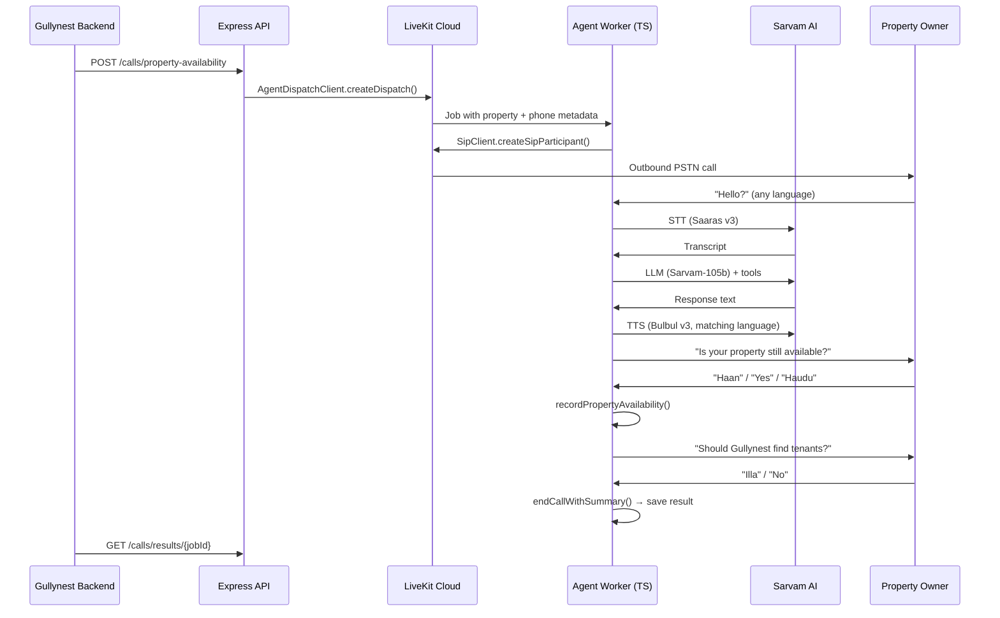

# Gully Voice Agent

**Modular Sarvam AI + LiveKit voice agent platform for Gullynest automated outbound calls.**  
**Calls property owners in Kannada, Hindi, or English to confirm availability and tenant-sourcing intent.**

Built with **TypeScript**, **LiveKit Agents (Node.js)**, and **Sarvam AI** (Saaras STT, Sarvam LLM, Bulbul TTS).

---

## Overview

This repository implements an automated outbound calling system for **Gullynest**. When a property listing needs verification, the system calls the owner and asks:

1. **Is your property still available?**
2. **If yes — should Gullynest help find tenants?**

Owners can answer in **English**, **Hindi**, or **Kannada** (*yes/no*, *haan/nahi*, *haudu/illa*). The agent automatically detects their language and responds in the same language.

---

## Architecture

```
┌─────────────────────────────────────────────────────────────────────────────┐
│                           GULLY VOICE AGENT PLATFORM (TypeScript)           │
├─────────────────────────────────────────────────────────────────────────────┤
│                                                                             │
│  ┌──────────────┐    POST /calls/...     ┌─────────────────────────────┐   │
│  │  Gullynest   │ ─────────────────────► │  Express Trigger API        │   │
│  │  Backend     │                        │  (src/api/server.ts)        │   │
│  └──────────────┘                        └──────────────┬──────────────┘   │
│                                                         │ Agent Dispatch    │
│                                                         ▼                   │
│  ┌──────────────────────────────────────────────────────────────────────┐  │
│  │                     LiveKit Cloud                                    │  │
│  │  ┌─────────────┐   SIP Trunk    ┌──────────────┐   WebRTC Room     │  │
│  │  │ Outbound    │ ─────────────► │ Property     │ ◄──────────────►  │  │
│  │  │ PSTN Dial   │                │ Owner Phone  │   Agent Worker    │  │
│  │  └─────────────┘                └──────────────┘                   │  │
│  └──────────────────────────────────────────────────────────────────────┘  │
│                                                         │                   │
│                                                         ▼                   │
│  ┌──────────────────────────────────────────────────────────────────────┐  │
│  │              LiveKit Agent Worker (Node.js / TypeScript)             │  │
│  │                                                                      │  │
│  │  ┌────────────────┐   ┌─────────────────┐   ┌───────────────────┐  │  │
│  │  │ Agent Registry │──►│ Property Agent  │──►│ LanguageManager   │  │  │
│  │  │ (pluggable)    │   │ (domain tools)  │   │ kn/hi/en detect   │  │  │
│  │  └────────────────┘   └─────────────────┘   └───────────────────┘  │  │
│  │                                                                      │  │
│  │  ┌─────────────────────────────────────────────────────────────────┐  │  │
│  │  │              Sarvam AI Pipeline (sarvam-pipeline.ts)            │  │  │
│  │  │  Saaras v3 STT  →  Sarvam-105b LLM  →  Bulbul v3 TTS         │  │  │
│  │  │  (auto LID)         (OpenAI-compatible)   (mulaw 8kHz PSTN)  │  │  │
│  │  └─────────────────────────────────────────────────────────────────┘  │  │
│  └──────────────────────────────────────────────────────────────────────┘  │
│                                                         │                   │
│                                                         ▼                   │
│  ┌──────────────────────────────────────────────────────────────────────┐  │
│  │  Call Result Store (JSON → swap for Postgres in production)          │  │
│  │  GET /calls/results/{jobId}                                         │  │
│  └──────────────────────────────────────────────────────────────────────┘  │
└─────────────────────────────────────────────────────────────────────────────┘
```

### Call Flow



---

## Project Structure

```
voiceAgent/
├── src/
│   ├── config/              # Environment settings
│   ├── core/                # Reusable framework
│   │   ├── base-agent.ts         # Multilingual agent factory
│   │   ├── language-manager.ts   # kn/hi/en + yes/no detection
│   │   ├── sarvam-pipeline.ts    # STT / LLM / TTS factory
│   │   └── worker.ts             # LiveKit entrypoint factory
│   ├── agents/              # Pluggable domain agents
│   │   ├── registry.ts
│   │   └── property-availability/
│   │       ├── agent.ts
│   │       └── prompts.ts
│   ├── jobs/                # Dispatch + result models
│   ├── api/                 # Express trigger API
│   ├── workers/             # LiveKit worker entrypoints
│   └── scripts/             # CLI utilities
├── tests/
├── package.json
├── tsconfig.json
└── .env.example
```

---

## Adding a New Voice Agent

```typescript
// src/agents/rent-reminder/agent.ts
import { registerAgent } from '../registry.js';
import { voice, llm } from '@livekit/agents';

class RentReminderAgent extends voice.Agent {
  constructor(metadata: Record<string, unknown>) {
    super({ instructions: '...', tools: { /* llm.tool(...) */ } });
  }
}

registerAgent('rent_reminder', (metadata) => new RentReminderAgent(metadata));
```

Then import the agent in your worker, add a dispatch method, and expose an API route.

---

## Prerequisites

| Service | Purpose |
|---------|---------|
| [Sarvam AI](https://dashboard.sarvam.ai) | STT, LLM, TTS (Indian languages) |
| [LiveKit Cloud](https://cloud.livekit.io) | Agent hosting + SIP telephony |
| Outbound SIP Trunk | PSTN calls (Twilio / Exotel / Wavix) |

---

## Quick Start

### 1. Install

```bash
cd voiceAgent
npm install
cp .env.example .env   # fill in API keys
```

### 2. Configure SIP (one-time)

Create an **outbound SIP trunk** in LiveKit and set `SIP_OUTBOUND_TRUNK_ID=ST_...` in `.env`.

### 3. Start the agent worker

```bash
npm run dev:worker
```

### 4. Test locally (no phone)

```bash
npm run console:worker
```

Speak in English, Hindi, or Kannada — the agent mirrors your language.

### 5. Start the trigger API

```bash
npm run dev:api
```

### 6. Trigger an outbound call

**Via API:**

```bash
curl -X POST http://localhost:8080/calls/property-availability \
  -H "Content-Type: application/json" \
  -d '{
    "owner_name": "Ramesh Kumar",
    "phone_number": "+919876543210",
    "property_id": "PROP-001",
    "property_address": "42, 5th Cross, Indiranagar, Bangalore",
    "bhk": "2 BHK",
    "rent_amount": 25000,
    "city": "Bangalore"
  }'
```

**Via CLI:**

```bash
npm run trigger:call -- \
  --owner-name "Ramesh Kumar" \
  --phone "+919876543210" \
  --property-id "PROP-001" \
  --address "42, 5th Cross, Indiranagar, Bangalore" \
  --bhk "2 BHK" \
  --rent 25000
```

### 7. Fetch call result

```bash
curl http://localhost:8080/calls/results/{job_id}
```

---

## Multilingual Support

| Language | Code | Yes | No | TTS Voice |
|----------|------|-----|-----|-----------|
| English | `en-IN` | yes, yeah | no, nope | aditya |
| Hindi | `hi-IN` | haan, ji | nahi, na | anand |
| Kannada | `kn-IN` | haudu | illa, beda | priya |

- **STT**: Saaras v3 with auto language detection
- **LLM**: Sarvam-105b via OpenAI-compatible API (`https://api.sarvam.ai/v1`)
- **TTS**: Bulbul v3 with per-language voice mapping
- **Tools**: `recordPropertyAvailability`, `recordTenantSourcingIntent`, `endCallWithSummary`

---

## Environment Variables

| Variable | Required | Description |
|----------|----------|-------------|
| `LIVEKIT_URL` | Yes | LiveKit WebSocket URL |
| `LIVEKIT_API_KEY` | Yes | LiveKit API key |
| `LIVEKIT_API_SECRET` | Yes | LiveKit API secret |
| `SARVAM_API_KEY` | Yes | Sarvam AI API key |
| `SIP_OUTBOUND_TRUNK_ID` | For calls | Outbound SIP trunk (`ST_...`) |
| `AGENT_NAME` | No | Dispatch name (default: `gully-property-availability-agent`) |
| `COMPANY_NAME` | No | Brand name (default: `Gullynest`) |

---

## Scripts

| Command | Description |
|---------|-------------|
| `npm run dev:worker` | Run agent worker in dev mode |
| `npm run start:worker` | Run agent worker in production mode |
| `npm run console:worker` | Test agent in terminal (no phone) |
| `npm run dev:api` | Start Express trigger API |
| `npm run trigger:call` | CLI to dispatch a call |
| `npm test` | Run unit tests |
| `npm run typecheck` | TypeScript type check |

---

## Production Notes

- Replace `CallResultStore` (JSON files) with Postgres/Redis
- Integrate with your job queue (BullMQ, n8n) to schedule calls
- Ensure TRAI DND compliance and owner consent
- TTS uses `mulaw` at 8 kHz for PSTN telephony
- Deploy worker to LiveKit Cloud: `npm run start:worker`

---

## License

Private — Gullynest internal use.
